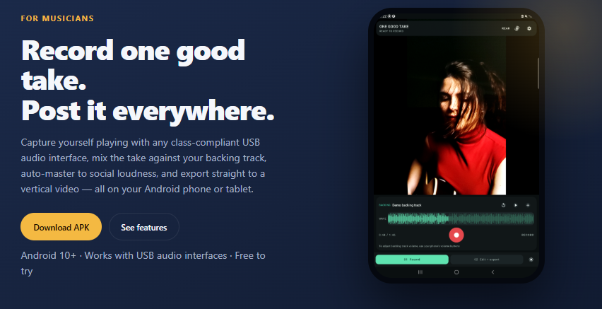

# One Good Take

[](LICENSE)
[](https://giannichiarello.com/product/donation/)

Android (API 29+) app for musicians: record one good take of yourself playing, straight to a social-media video with proper multitrack audio
(backing track + external audio interface), mix (gain/EQ/reverb per track), and one-button
auto-master for social-media loudness (-14 LUFS). Kotlin + Jetpack Compose + CameraX.

Repository: https://github.com/GreenDelrin/OneGoodTake

Live site (screenshots, features, download): https://giannichiarello.com/OneGoodTake/



## Download

Grab the latest APK from the [Releases](https://github.com/GreenDelrin/OneGoodTake/releases/latest) page, or download v1.9 directly:
[OneGoodTake_v1_9.apk](https://github.com/GreenDelrin/OneGoodTake/releases/download/v1.9/OneGoodTake_v1_9.apk)

Install it (you may need to allow "install unknown apps" for your browser/file manager).

## Build

```sh
JAVA_HOME="C:/Program Files/Eclipse Adoptium/jdk-17.0.18.8-hotspot" ./gradlew assembleDebug
```

Release builds are signed with the project keystore (not committed). See `app/build.gradle.kts`.

## Direct USB capture (experimental)

- Direct USB / UAC2 is selected by default when a USB input is available; grant USB access and test the input.
- Capture runs through native `usbdevfs` isochronous USB requests at 48 kHz, then records the chosen first input or first two inputs as the app's existing 16-bit mono/stereo WAV.
- Native capture claims only the input stream interface so Android can continue routing backing playback through the device's output interface. If native capture fails, the app automatically tries Android `AudioRecord`; both Android profiles remain selectable.
- The app restores the selected settings, backing file, current take, and mix/master workspace after relaunch; it does not resume playback or recording.
- Adapted from the supplied `UsbAudioProbe` project, whose README declares the code MIT-licensed; that folder contained no separate license or copyright notice. Confirm attribution before commercial distribution. This path has not yet been tested with physical hardware.

## Editing

- Recording uses a full-screen camera preview with social safe-area guides and a backing-track restart control.
- Mix keeps the video visible, provides backing/take lanes, trim-in/trim-out, per-track effects, and a streaming audio preview that responds to edits while playing.
- Final video trims snap to the next encoded keyframe; frame-accurate re-encoding is not implemented.

## Support the developer

This app is free and open source. If it helps you, consider supporting development:
https://giannichiarello.com/product/donation/

There is also a "Support the developer" button inside the app's setup wizard.

## License

This project is licensed under the MIT License - see [LICENSE](LICENSE).

### Third-party software

- AndroidX, Jetpack Compose, CameraX, Media3 - Apache License 2.0
- Kotlin and kotlinx.coroutines - Apache License 2.0
- USB audio capture adapted from `UsbAudioProbe` (MIT-licensed; no separate copyright notice present in the source folder)

All dependencies are fetched from Google Maven and Maven Central. No proprietary SDKs are used.

## Contributing

Issues and pull requests are welcome: https://github.com/GreenDelrin/OneGoodTake/issues